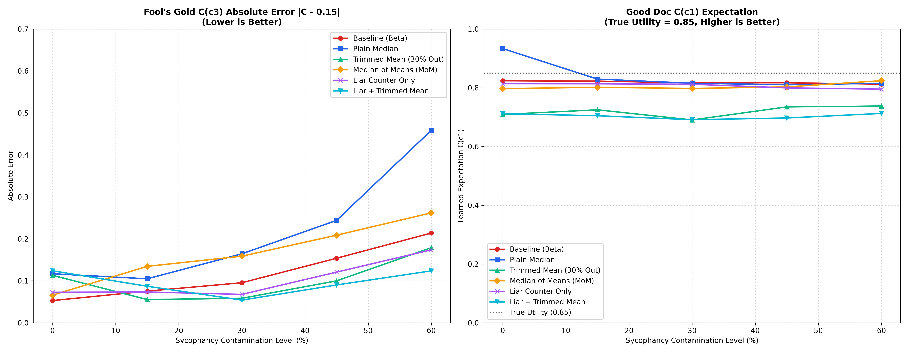
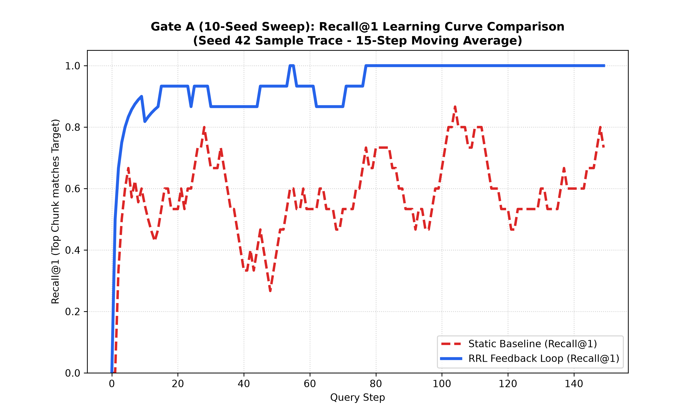
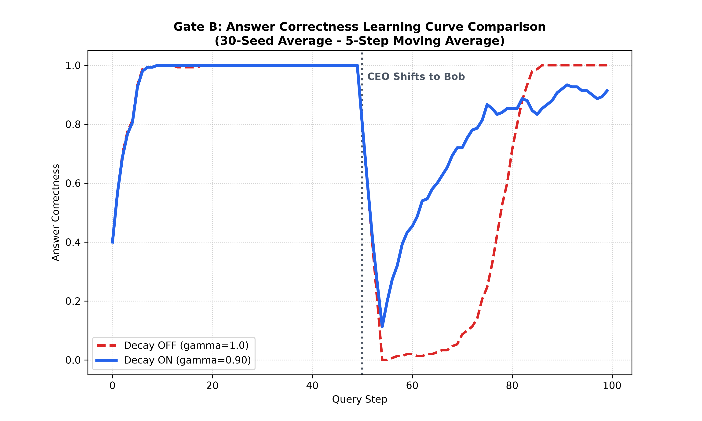
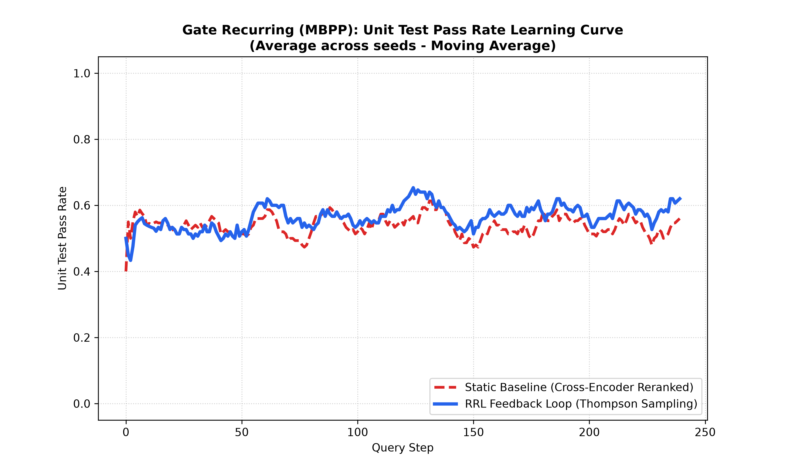

# RRL — A Retrieval Reputation Layer

[](https://github.com/pras-ops/retrieval-reputation-layer/actions/workflows/ci.yml)
[](https://pypi.org/project/retrieval-reputation-layer/)
[](https://pypi.org/project/retrieval-reputation-layer/)
[](https://opensource.org/licenses/MIT)

> **RRL** = **R**etrieval **R**eputation **L**ayer. *Not* to be confused with Cache-Augmented
> Generation ("CAG"); RRL is a ranking-time reputation layer, not a retrieval-free method.

RRL is **not a retriever.** It is a lightweight, training-free **selection layer that sits on
top of any retriever or tool registry and turns verified outcomes into a ranking signal**: it
learns which documents or tools *actually worked*, shares that across related requests, trusts
other feedback (users, LLM judges, a tool's own success report) only as far as a verifier has
confirmed it — per document or tool — and resets an item's reputation when its results change.

It was first built to make a web-scraping agent learn which extractor works on which site, and
is now evaluated on agent **tool / MCP selection** — over live MCP servers (Gate M) and on real
ToolRet tool descriptions (Gate T) — and on **web-scraping tool selection** (Gate W), alongside
RAG benchmarks.

The ranking rule (similarity + learned usefulness) overlaps with MemRL (arXiv 2601.03192) and
with RATED (CIKM 2026), which learns tool reliability from execution feedback; audit-anchored
source trust has been studied in theory by ESA (EWRL 2026). What RRL contributes is combining
**verifier-anchored, per-item trust in feedback** with tool selection and per-context memory, for
agents whose tools can mislead through their descriptions or their own success reports — and an
evaluation, including live MCP servers, of where that helps and where simpler methods win. See
[PAPER.md](PAPER.md).

> **What it is:** a reputation / usefulness-and-freshness layer for closed-loop retrieval.
> **What it is not:** a better retriever, or a truth detector. It adds no value where queries
> don't recur or where there's no trustworthy feedback to learn from.

### When it helps — and when it doesn't (the boundary condition)

The central, evidence-backed claim is deliberately **conditional**:

> **Recurrence + a trustworthy verifier →** RRL accumulates outcome signal and helps.
> **No recurrence →** RRL cannot accumulate signal and *slightly underperforms* a strong
> baseline (a small exploration tax).

Both halves are demonstrated. We show a strong cross-encoder reranker **beating** RRL in a
one-shot, non-recurring setting (Gate C) — that boundary is stated up front, not hidden. The
*same* mechanism explains both the wins and the loss, which is the point: this is outcome-aware
retrieval *under specific conditions*, not a universally superior retriever.

This is a **research/experimental** project built around honest evaluation. See
[Validation Status](#validation-status) for exactly what is and isn't established.

---

## Where it fits

Two properties decide whether RRL helps: **trustworthy feedback** (a verifier, or a
controlled/trusted source) and **repetition** (similar queries recur enough for counters to
converge).

| Use case | Fit | Why |
|---|---|---|
| **Agent tool / MCP selection** | **Strongest** when some tools' descriptions or self-reports mislead and only some calls can be verified | Tools are reused across requests, calls can be spot-checked, tools change (Gates M, T) |
| **Web-scraping extractor selection** | **Strongest** under sparse verification and new sites | Same tools across many sites, extractors over-report success, sites redesign (Gate W) |
| **Coding agents with *recurring* tasks** (reused fix patterns / snippets) | Strong | Hard verifier (tests) **+ recurring problem families** → reputation converges |
| **Enterprise RAG over trusted docs** | Strong | Recurring question types + controlled source; decay handles *staleness* |
| **Internal tools / agents over controlled data** | Strong | Same logic as above |
| **One-shot / non-recurring retrieval** | **No value** | Nothing to accumulate — a strong reranker wins (Gate C boundary) |
| **Open web / public user-generated content** | **Avoid** | Adversarial + unverifiable feedback → the >50% identifiability wall (see Limitations) |

---

## Architecture

```
  ANY retriever (yours, or the bundled retriever.py: hybrid vec+BM25, RRF-fused)
        │
        │  sims: {candidate_id: relevance}
        ▼
  ┌───────────────────────────────┐      counters       ┌────────────────────────┐
  │           layer.py            │ ◄─────────────────► │  store.py / store_     │
  │  ReputationLayer.rescore()    │                     │  sqlite.py (persistent,│
  │  w_sim·sim + w_c·C_robust     │   pending shares    │  atomic, lazy decay,   │
  │  + w_p·P + Thompson explore   │ ──────────────────► │  pending bridge)       │
  └────────────┬──────────────────┘                     └───────────▲────────────┘
               │ top-k + response_id                                │ counter update
               ▼                                                    │
        your generation step                          ┌─────────────┴────────────┐
               │                    feedback (y)      │        feedback.py       │
               └────────────────────────────────────► │  outcome y, κ, liar      │
                 record_feedback(response_id, ...)    │  counter, robust est.    │
                    (s_gt / s_behave / s_judge)       └──────────────────────────┘
```

| Module | Responsibility |
|---|---|
| `rrl/layer.py` | **`ReputationLayer`** — the retriever-agnostic core: `rescore()` (reputation scoring, Thompson-sampling exploration, ε-greedy, credit shares) and `record_feedback()` |
| `rrl/store.py` | `Candidate` dataclass (α/β, A/B, `fooled`/`verified`, `recent_outcomes`) + in-memory `CandidateStore` (incl. `pending` bridge) |
| `rrl/store_sqlite.py` | Persistent store: durable, **lazy decay**, **atomic increments**, `pending` (retrieve↔feedback bridge), schema migration |
| `rrl/retriever.py` | Optional bundled retriever: hybrid retrieval (SentenceTransformer + custom BM25, RRF-fused), delegating scoring to `ReputationLayer` |
| `rrl/feedback.py` | Outcome aggregation `y`, soft κ-weighted update, liar counter, robust estimators, optional ADT denoising |
| `rrl/reliability.py` | **`SourceReliability`** (opt-in): each feedback source's sensitivity and specificity against the verifier, globally and per document; combines unverified signals |
| `rrl/drift.py` | **`ChangeDetector`** (opt-in): two-window z-test on recent outcomes; resets a document's (or a context's) counters on a change |
| `rrl/judge.py` | LLM faithfulness judge (Gemini) with a token-overlap fallback when offline |
| `rrl/ingest.py` | Document chunking + embedding into candidates |
| `rrl/api.py` | FastAPI service: `POST /retrieve`, `POST /feedback`, `GET /health` |
| `rrl/integrations/` | Optional adapters: `langchain.py` (`RRLRetriever`), `llama_index.py` (`RRLLlamaIndexRetriever`) |

---

## Install

Requires Python 3.10+. Install the package with the extras you need:

```bash
pip install -e .                 # core reputation layer (only requires numpy)
pip install -e ".[embeddings]"   # + built-in retriever support (sentence-transformers)
pip install -e ".[api]"          # + FastAPI service
pip install -e ".[llm]"          # + live LLM judge (else heuristic fallback)
pip install -e ".[dev]"          # + simulations, plots, and testing (includes scipy, scikit-learn)
pip install -e ".[api,llm,dev]"  # everything
```

To reproduce the benchmark gates against the exact validated dependency versions, use the
pinned set instead: `pip install -r requirements.txt`.

> [!NOTE]
> The first retrieval using the built-in retriever downloads the `all-MiniLM-L6-v2` model (~80 MB).
> The LLM judge needs `GEMINI_API_KEY` or Vertex AI credentials; without them it falls back to a local heuristic.

---

## Quickstart (library)

```python
from rrl import CandidateStore, ReputationLayer

store = CandidateStore()
layer = ReputationLayer(store)

# 1. Provide candidate relevance scores from ANY retriever:
res = layer.rescore({"doc1": 0.9, "doc2": 0.4}, top_k=2)

# 2. Record downstream feedback (behavior, ground-truth tests, judge, etc.)
layer.record_feedback(res.response_id, s_behave=0.75, s_gt=1.0)
```

The full configuration used in the benchmarks adds verifier-anchored source trust, change
detection and per-context reputation:

```python
from rrl import ChangeDetector, SourceReliability

layer = ReputationLayer(
    store,
    gamma=1.0,  # no time decay; changes are detected instead
    reliability=SourceReliability(),  # trust users / judges / self-reports per item
    change_detector=ChangeDetector(),  # reset an item when its results shift
    stick_to_verified=True,  # keep a verifier-confirmed tool per context
)
res = layer.rescore(
    {"jsonld_extractor": 0.8, "universal_extractor": 0.9},  # relevance, e.g. reranker-blended
    top_k=1,
    cluster_id="site:shop.example",  # optional: learn per context, shrunk to global
)
# Verified when a spot check ran; otherwise only the trusted sources move the counters.
layer.record_feedback(res.response_id, s_behave=1.0, s_judge=1.0, s_gt=None)
```


## Quickstart (API)

```bash
uvicorn rrl.api:app --reload     # uses SqliteCandidateStore at $RRL_DB_PATH (default rrl.db)
```

```bash
# 1) retrieve — returns a response_id and freezes credit shares server-side
curl -X POST localhost:8000/retrieve -H 'content-type: application/json' \
  -d '{"query":"how do I avoid db anomalies?","top_k":3}'

# 2) feedback — references that response_id; updates counters atomically
curl -X POST localhost:8000/feedback -H 'content-type: application/json' \
  -d '{"response_id":"<id-from-step-1>","s_behave":0.9,"s_gt":1.0}'
```

`/retrieve` persists the frozen credit shares to the `pending` table; `/feedback` pops them
and applies the update through the store's **atomic** `increment()` — safe under concurrent
requests.

---

## Quickstart (LangChain / LlamaIndex)

Adapters wrap the bundled `Retriever` for use inside existing chains/pipelines.

```bash
pip install "retrieval-reputation-layer[embeddings,langchain]"    # or [embeddings,llamaindex]
```

```python
from rrl.integrations.langchain import RRLRetriever
from rrl.feedback import OutcomeSignals

lc_retriever = RRLRetriever(rrl_retriever=retriever)  # retriever = rrl.Retriever(store)
docs = lc_retriever.invoke("how do I avoid db anomalies?")

# After observing the outcome downstream:
lc_retriever.record_feedback(docs, OutcomeSignals(s_behave=0.9, s_gt=1.0))
```

`rrl.integrations.llama_index.RRLLlamaIndexRetriever` follows the same shape for LlamaIndex's
`BaseRetriever` / `NodeWithScore`.

> **Scope note:** these adapters currently feed back through `update_counters()` with one
> shared outcome per retrieval batch — the simpler, batch-level path, not the per-response
> `response_id` credit-share bridge used by `ReputationLayer`/the FastAPI service. Prefer
> `ReputationLayer.rescore()` directly (see the library quickstart above) if you need
> per-document credit attribution inside a custom pipeline.

---

## How it works

**Ranking.** Each candidate is scored:
```
score(i) = w_sim·sim(i) + w_c·C_robust(i) + w_p·P(i)         # exploitation
         + w_explore·sim(i)·(ThompsonSample(α,β) + rarity)   # exploration (when explore=True)
```
- `sim(i)` — hybrid vector+BM25 relevance, RRF-fused and normalized.
- `C_robust(i)` — recent usefulness (Beta mean by default; see robust estimators).
- `P(i) = A/(A+B)` — long-term usefulness.
- Exploration is **scaled by `sim`** so it never surfaces wholly irrelevant docs.

**Outcome.** Feedback signals are aggregated into `y ∈ [0,1]`. If a verifier `s_gt` is present
it overrides (it's the one signal that can't be faked). Otherwise:
- **default:** a weighted mean of `s_behave (0.45)`, `s_gt (0.30)`, `s_judge (0.15)`,
  `s_expl (0.10)`, renormalized over present signals, with the behavioral cap and liar counter;
- **with `SourceReliability`:** each source is a two-coin annotator (Dawid & Skene 1979) whose
  sensitivity and specificity are learned against the verifier, globally and per document
  (shrunk toward global). `y = σ(logit(base rate) + Σ log-likelihood ratios)`. A source that
  cannot tell success from failure — e.g. one that always says "worked" — carries no weight, and
  if no present source carries any, the update is skipped.

**Update.** Decisiveness `κ = 2·|y−0.5|`; credit share `r(i)` from similarity (smoothed);
`α += κ·r·y`, `β += κ·r·(1−y)` (permanent A/B at a 0.25 rate). An ambiguous outcome (`y≈0.5`)
barely moves the counters; a decisive one moves them fully.

**Decay.** `x ← 1 + (x−1)·γ^Δt` pulls stale counters back toward the prior, computed lazily
from `last_updated` (no cron sweep).

**Change detection** (`ChangeDetector`, opt-in). A two-proportion z-test (α = 0.01) on the last
two windows of 8 outcomes; on a change the short-term counters are rebuilt from the recent
window. A fixed threshold (`threshold=0.6`, window 4) is still available; it detects faster but
resets often when an item's results vary by context. Benchmarks report resets per run.

**Per-context reputation** (`cluster_id`). Counters are also kept per context (a site, a
request type) and blended with the item's global counters with weight `n / (n + 4)`, where `n` is
the context's evidence: a new context starts from the global reputation, and its own outcomes
take over as they accumulate.

**Exploration weight.** The library default is `w_explore = 0.10`. The benchmarks use the Gate E
configuration `(0.20, 0.40, 0.10, 0.30)`; the ablations show 0.10 is equal or better there.

---

## Robustness & denoising

Naive learning from implicit feedback can degrade — a known result in the literature. RRL
includes safeguards, evaluated in a 20-seed ablation (`sim/verify_robustness.py`):

| Mechanism | Status | Notes |
|---|---|---|
| **Behavioral cap** (positive `s_behave` ≤ 0.75) | **Adopted** | Asymmetric: trusts rejections fully, caps sycophantic "accepts" |
| **Verifier anchor** (`gt_override`) | **Adopted** | The one sycophancy-proof signal dominates when present |
| **Liar counter** (`fooled`/`verified` → per-doc `trust_score`) | **Adopted (default)** | Detects "accepted-but-verifier-failed"; lowest collateral damage to good docs |
| Trimmed mean (drop top 30%) | **Rejected** | Strong on contaminated data but biased *down* on clean data — craters good docs |
| Median-of-Means | **Rejected** | Block-averaging pre-mixes uniform contamination → ≈ the plain mean |
| ADT loss-downweighting | Optional, off by default | Helps *random* noise; does **not** help sycophancy (the lie is low-loss) |

**Honest bound:** these *mitigate* sycophancy, they do not *solve* it. Effectiveness is capped
by verifier coverage, and above ~50% contamination no estimator on the feedback values alone
can recover truth (information-theoretic). Robust estimator modes are selectable via
`robust_estimator_mode` (`"beta"` default, `"median"`, `"trimmed"`, `"mom"`).



---

## Validation Status

Reported honestly — what the tests/sims actually establish, and what they don't.

### Current benchmarks (Gates M, T, W, G, F) — full tables in [RESULTS.md](RESULTS.md)

All replay offline from committed data, 30 seeds, paired statistics, with ablations
(`--ablation`) of every RRL component. Both learning baselines use the verifier whenever it ran.

| Gate | What it tests | Headline |
|---|---|---|
| **M** — live MCP servers (`sim/run_gate_m.py`) | Real MCP tools over stdio on local servers; a poisoned server with an injected instruction; a mid-run tool update; a flaky server; Gemini picking from the tool list; fully live runs agree with the replay | Reranker and Gemini pick the poisoned tool (0–8% solved); **RRL 43–67%**. With 20% spot checks MemRL-style (3–4%) and a robust per-site memory (22–25%) are fooled; RRL keeps 43–52% and leads on new sites. With every call verified, the robust per-site memory leads by 8–21 points |
| **T** — tool selection (`sim/run_gate_t.py`) | Real ToolRet requests and tool descriptions; tool updates, poisoned twins, flaky tools, held-out requests | Learning beats the static reranker (≈30% → 41–59%); **RRL and MemRL-style are close** (−2.4 to +4.6 points at exploration 0.10) |
| **W** — web-scraping tools (`sim/run_gate_w.py`) | 8 executable extractors on 30 generated shops; tools' own success reports; redesigns; held-out sites | Same pattern as M: RRL resists over-reporting tools under sparse verification and generalizes to new sites; per-site memory wins when every call is verified |
| **G** — private-API docs (`sim/run_gate_g.py`) | Real Gemini code against a generated library; poisoned guides; API switch | About level with MemRL-style without drift; **MemRL-style adapts 9–21 points better** after an API switch |
| **F** — MBPP, leak-free (`sim/run_gate_matrix.py`) | Gate E without the answer leak, replayable | Retrieval barely changes the outcome (reranker 57.1% = no retrieval 57.2%) |

**Where RRL helps:** selecting among tools whose descriptions or self-reports can mislead, with
only some calls verifiable, and with new contexts appearing. **Where it does not:** when every
call is verified, contexts recur and no tool misleads (a per-context memory is simpler and
better), and under abrupt changes with trustworthy feedback (a fast-forgetting average adapts
sooner). The recommended configuration adds `stick_to_verified=True` with a per-context
`cluster_id`, which closes most of the gap to per-context memory.

**Change detection is a trade-off:** the default z-test detector avoids false resets, the
original fast detector (`ChangeDetector(window=4, threshold=0.6)`) adapts faster to abrupt
changes. **Exploration:** prefer the library default 0.10 over the 0.30 used in the benchmark
configuration.

### Validated ✅ — under recurrence + a verifier
- **Persistence layer** (`tests/test_store_sqlite.py`): durability across reconnect, lazy
  decay math, **atomic concurrent increments** (8 threads × 200, zero lost updates), and the
  pending retrieve↔feedback bridge. (35 tests pass, no resource leaks.)
- **API atomic path**: `/feedback` routes through `store.increment()`, not a Python
  read-modify-write — verified in the code path.
- **Robustness ablation** (20-seed): supports adopting the liar counter and rejecting
  trimmed-mean / MoM (below).
- **Gate A — outcome-aware ranking helps under recurrence** (`sim/run_gate_a.py`): 10-seed,
  top_k=1, with an **independent answer-verifier** that inspects only the generated answer
  (never the retrieved doc IDs), so the training signal can't leak the eval label. Under
  recurrence, RRL's answer correctness separates from a static baseline with **non-overlapping
  95% CIs**. *Scope:* controlled corpus, synthetic keyword-verifier — a proof of mechanism, not
  a production number.
  
  
- **Gate B — decay helps adaptation** (`sim/run_gate_b.py`, **30-seed**): ground truth flips at
  step 50. Post-shift correctness (re-run with the current code): decay-OFF
  **0.488 [0.457, 0.519]** vs decay-ON **0.709 [0.651, 0.768]** — **non-overlapping CIs**
  (an earlier version reported 0.417 vs 0.730). Decay is what lets stale reputation fade.
  
  
- **Gate D — recurrence beats a strong reranker** (`sim/run_gate_d.py`): recurring-query
  benchmark (epochs over a fixed problem set) against a **cross-encoder** reranker. With
  recurrence, RRL (**global counters**) overtakes the reranker — the same reranker that *wins*
  without recurrence (Gate C). *Scope:* controlled synthetic hint corpus; see the realistic
  benchmark below.
  
  
- **Gate E — superseded; see Gate F.** Two problems surfaced on review. (1) The corpus contains each query's own reference solution, so the useful document is the answer itself (in the cached data it passes 78.8% of the time, vs ~30% for any other document). (2) The RRL arm cannot be replayed from the committed cache. Kept for the record (`sim/run_gate_recurring.py`, MBPP): 10 independent seeds, 8 recurring epochs, **real Gemini generation**, **real unit-test verifier**. Under natural recurrence of programming problem families, RRL with global counters scores higher than a strong cross-encoder baseline. Overall pass rate: static baseline **54.0% [40.6%, 67.4%]** vs RRL **56.9% [50.9%, 62.8%]**. Late-stage pass rate: static baseline **54.2% [39.9%, 68.5%]** vs RRL **59.0% [52.5%, 65.4%]**. *At 10 seeds the CIs still overlap, so the lift is directional, not yet significant;* more seeds or a paired per-seed test would settle it, as 30 seeds did for Gate B. Details in [RESULTS.md](RESULTS.md).

  

### Boundary condition ⛔ — stated, not hidden
- **Gate C — no recurrence → a strong reranker wins** (`sim/run_gate_c.py`): one-shot HumanEval
  (50 distinct problems, ~1 visit each), **real Gemini generation**, **real unit-test verifier**.
  A production-grade cross-encoder reranker **beats RRL** — overall **65.2% [60.6, 69.8]** vs
  RRL **59.4% [54.4, 64.4]**. With no repeated traffic, the reputation loop has nothing to
  accumulate, so RRL only pays a small exploration tax. *This negative result is central* — it
  constrains the claim to the recurrence regime instead of pretending RRL is universally better.
  
  

### NOT yet validated ⚠️ (the important part)
- **Third-party tools.** Gate M runs real MCP servers, but local ones written for the test,
  against a generated website; no third-party MCP servers or live sites have been used.
- **Without any verifier.** Gates use a verifier on 20–100% of steps. With none, source
  reliability has nothing to learn from and RRL skips unverified feedback.
- **Per-context reputation** helps when usefulness depends on a recurring context (Gate W) but
  not when every request is new; automatic clustering of contexts is not evaluated.
- **Natural corpora and real MemRL code**: only a MemRL-style reimplementation on RRL's gates.
- **Real-traffic degeneracy** (popularity-bias amplification): not yet monitored.

---

## Limitations & scope

- **Not a truth detector.** It tracks usefulness and freshness, not correctness.
- **Verifier-bounded.** Robustness against bad feedback rises and falls with how often a
  verifier (`s_gt`) is available.
- **The >50% wall.** If a majority of feedback for an item is dishonest, no statistic on the
  feedback alone recovers truth — by information theory. Scope RRL to controlled/verifiable
  settings.
- **Exploration cost.** Exploration improves discovery but can evict correct results from a
  small top-k; tune `epsilon`/`explore` to your top-k.
- **Mostly established ideas.** Beta reputation, bandit exploration, Dawid–Skene source
  reliability and window-based change detection are all known; the ranking rule overlaps with
  MemRL. What is specific to RRL is combining verifier-anchored, per-item trust with
  outcome-driven selection, and evaluating where that helps and where it does not.

---

## Repository layout

```
rrl/                  core library (layer, store, retriever, feedback, judge, ingest, api, store_sqlite)
sim/                  gates: verify_robustness.py, run_gate_a.py (value), run_gate_b.py (decay),
                      run_gate_c.py (no-recurrence boundary), run_gate_d.py (synthetic recurrence),
                      run_gate_recurring.py (Gate E, superseded), run_gate_matrix.py (Gate F,
                      leak-free MBPP replay; shared policies and statistics), run_gate_g.py
                      (Gate G, private-API docs), run_gate_t.py (Gate T, tool selection on
                      ToolRet), run_gate_w.py (Gate W, web-scraping tools), run_gate_m.py (Gate M,
                      live MCP servers) + mcp_testbed/ (shop site, MCP servers, client),
                      summarize_results.py,
                      plot_gate_f_map.py (similarity-vs-usefulness map), gate_c_verifier.py
data/                 HumanEval.jsonl (164 problems, OpenAI · MIT) and mbpp.jsonl (974 problems,
                      Google MBPP · CC-BY-4.0) — real unit-test verifier substrates;
                      matrix_outcomes_*.jsonl + gate_f_pools_*.json (Gate F outcome tables, pools);
                      gate_g/ (generated zyn library v1/v2, pools, outcome tables);
                      gate_t/ (ToolRet-derived ids, scores and labels; raw data is downloaded by
                      --build, not committed — ToolRet states no license);
                      gate_m/ (recorded MCP responses, tool registry, pools, Gemini tool plans)
tests/                test_feedback.py, test_store_sqlite.py, test_robustness.py, test_api.py,
                      test_layer.py, test_reliability.py, ...
ROADMAP.md            phased build plan
```

## Running tests & simulations

```bash
python3 -m pytest tests -q                               # unit tests
python3 sim/verify_robustness.py                         # robustness ablation (20-seed)
python3 sim/run_gate_a.py                                # Gate A: value under recurrence (10-seed)
python3 sim/run_gate_b.py                                # Gate B: decay / freshness (30-seed)
python3 sim/run_gate_c.py                                # Gate C: no-recurrence boundary (needs Gemini)
python3 sim/run_gate_recurring.py --selftest            # realistic benchmark: offline plumbing check
USE_REAL_GEMINI=true python3 sim/run_gate_recurring.py   # Gate E (superseded; answer-key leak)
python3 sim/run_gate_matrix.py --selftest                # Gate F: offline plumbing check
python3 sim/run_gate_matrix.py --generator gemini --scenario all   # Gate F replay (table in data/)
python3 sim/run_gate_g.py --selftest                     # Gate G: library + docs + replay check
python3 sim/run_gate_g.py --scenario all                 # Gate G replay (table in data/gate_g/)
python3 sim/run_gate_g.py --variant hard --scenario all --ablation
python3 sim/run_gate_t.py --scenario all --ablation        # Gate T replay (data/gate_t/)
python3 sim/run_gate_t.py --build                         # re-download ToolRet, rebuild pools
python3 sim/run_gate_w.py --scenario all --ablation        # Gate W (fully offline)
python3 sim/run_gate_m.py --selftest                      # Gate M: starts local MCP servers
python3 sim/run_gate_m.py --scenario all --ablation        # Gate M replay (data/gate_m/)
python3 sim/run_gate_m.py --live --seeds 3 --scenario update  # Gate M with real MCP calls
python3 sim/run_gate_m.py --record                        # re-record all MCP responses
python3 sim/summarize_results.py                         # result tables for RESULTS.md
```

Gate F and Gate G build their outcome tables once with `--build` (Gemini calls; needs
`USE_REAL_GEMINI=true` and credentials). Every later run replays the committed tables offline.

## Related work

RRL sits between two active areas, and is deliberately a *smaller* mechanism than either.
Full positioning + citations in [RELATED_WORK.md](RELATED_WORK.md).

- **Agent memory / experience reuse** — Evo-Memory + ReMem ([arXiv:2511.20857](https://arxiv.org/abs/2511.20857)),
  ExpeL, Agent Workflow Memory, Dynamic Cheatsheet, Agentic Context Engineering. These
  *extract and inject* workflows/insights at the prompt level. **RRL works one level lower** —
  per-document Beta reputation at the *ranking* level, writing no new memory artifacts and
  putting no LLM in the memory loop.
- **Online / feedback RAG reranking & LTR** — DynamicRAG, AutoRAG-HP, LTRR, Online-Optimized
  RAG, REARANK. These *train/prompt a reranker* from feedback. **RRL keeps the reranker fixed**
  and adds a non-parametric reputation prior with staleness decay, noise/sycophancy safeguards,
  and a stated boundary condition.
- **Statistical lineage (not novel, by design)** — Beta Reputation System (Jøsang & Ismail
  2002), Beta-Bernoulli click models, bandit learning-to-rank. The contribution is the clean,
  safeguarded, honestly-evaluated *integration*, not the estimator.
- **Evaluation honesty** — aligns with ["Benchmarking is Broken"](https://arxiv.org/html/2510.07575v2);
  RRL independently caught and fixed an LLM-judge circularity (see Gate A history).

**Not yet compared on** the standard streaming benchmark (Evo-Memory) or a strong full stack —
see [RELATED_WORK.md](RELATED_WORK.md) for the honest gap list.

## Future work

1. **Third-party MCP evaluation.** Run RRL as the tool-selection layer on third-party MCP
   servers and benchmarks (MCPEvol-Bench, MCPTox environments), and compare with MemRL's code.
2. **Exploit recurring contexts better.** `stick_to_verified` closed most of the gap to
   per-context "reuse what worked" when every call is verified, but not all of it (4–16 points
   remain); a confidence gate on exploration did not help at all.
3. **Change detection that is both fast and quiet** — e.g. per-context detection or a CUSUM /
   Page-Hinkley test — to close the gap to MemRL-style under abrupt changes.
4. **Strong-stack comparison.** *Strong Stack* vs *Strong Stack + RRL* (hybrid retrieval +
   query rewriting + multi-query + agent memory), not just retriever-level. The eventual
   deployment-relevant test.
5. **No-verifier validation** — behavior under purely behavioral/judge feedback (e.g.
   cross-model agreement as a pseudo-verifier).
6. **Degeneracy monitoring** (retrieval concentration / coverage) before any real deployment.

See `ROADMAP.md` for the full plan.

---

## License

This project is licensed under the MIT License - see the [LICENSE](LICENSE) file for details.

